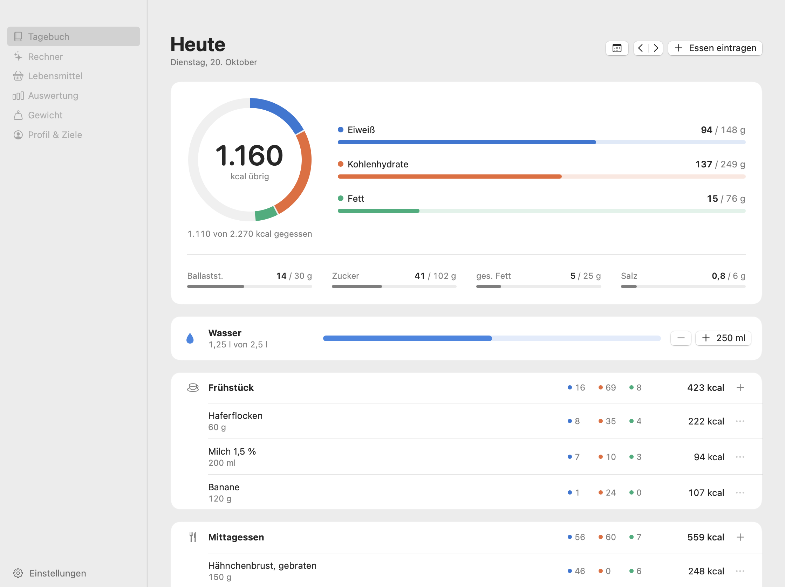
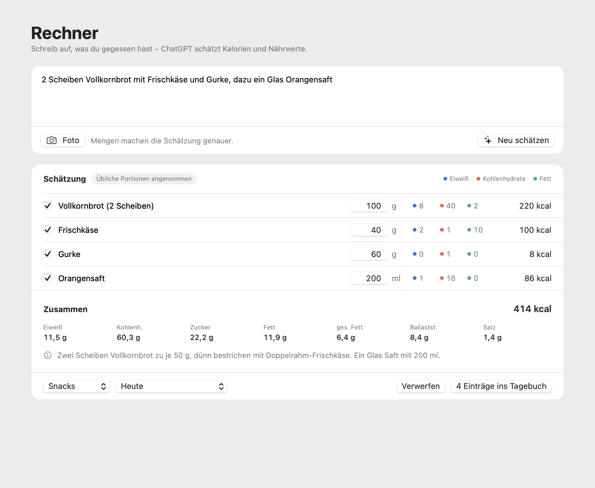

<div align="center">



# Kost

**A food diary for the Mac. Write down what you ate in normal words or drop in a photo, and ChatGPT estimates the calories and nutrients with your own ChatGPT subscription.**


</div>



## What is this?

Kost tracks calories, protein, carbs (and sugar), fat (and saturated fat), fiber, salt, water and body weight. Instead of typing in every food by hand, you describe a meal in one sentence or show it in a photo. ChatGPT splits it into single foods and estimates each one. You can still change the amounts before anything goes into the diary.



## What it can do

- **Setup** on the first start: sex, age, height, weight, activity and goal. From that Kost calculates the basal metabolic rate (Mifflin-St Jeor), the daily energy use and the daily targets. The profile page shows every step of the calculation, and you can set the targets by hand.
- **Diary** for each day with four meals, a calorie ring, macros, the other nutrients and a water counter. Entries can be edited, copied and moved, and an empty meal offers the same meal from the day before.
- **Calculator**: text and up to four photos go to ChatGPT. The result comes back as single items whose amounts you can change.
- **Foods**: your own collection with favorites, recently eaten foods and a product search in [Open Food Facts](https://world.openfoodfacts.org) by name or barcode number.
- **Statistics** for 7, 30 or 90 days, and **weight** with history, trend and BMI.
- **Settings**: ChatGPT sign-in and model, glass size, CSV export and where the data is stored.

## How the estimate works

Kost uses "Sign in with ChatGPT" the way OpenAI describes it for apps that run locally ([token sharing for open source apps](https://developers.openai.com/siwc/token-sharing-open-source)):

- OAuth with PKCE in the browser, with the callback going to a small server on `127.0.0.1`.
- The client ID comes from dynamic registration, so there is nothing secret in the code.
- The estimate is a request to the Responses API that runs on the user's Plus or Pro subscription, with `store: false` and streaming, as OpenAI requires.

The model setting "Automatic" measures once which model of the account answers fastest, and measures again when the list of models changes or after two weeks.

The sign-in code is in `Sources/KostKern/ChatGPT.swift`, the prompt and the answer schema are in `Sources/KostKern/Schaetzauftrag.swift`.

## Things I learned

- **Refresh tokens rotate.** If two processes refresh the same token at the same time, the second one signs the first one out. That's why only one refresh can run at a time, and the session file is read again before it is used. Before you test from the command line, quit the app.
- **A 403 is not always your fault.** The authorize page answers `curl` with 403 because of bot protection. That says nothing about wrong parameters, only the real browser flow does.
- **Checking the design without screen recording.** `Kost --bildprobe <folder>` draws every page in light and dark mode with made-up sample data into PNG files. The images in this README come from there.

## Run it

```bash
./build.sh
```

```bash
open Kost.app
```

You need macOS 14 or newer and Swift 5.9 or newer (Xcode or the Command Line Tools). The build is universal for Apple Silicon and Intel. Tests run with `swift test`.

To check the ChatGPT connection without the window (uses the saved sign-in):

```bash
Kost.app/Contents/MacOS/Kost --modelle --messen
```

```bash
Kost.app/Contents/MacOS/Kost --schaetze "2 Brötchen mit Butter und Gouda"
```

## Share it

```bash
./build.sh --verteilen
```

This makes `Kost.dmg` with the app, a link to Applications and a short guide. The app is only signed ad hoc and not notarized, so on another Mac it has to be allowed once under System Settings › Privacy & Security › "Open Anyway".

## Your data

Everything stays on your Mac in one readable file: `~/Library/Application Support/Kost/daten.json`. If that file can't be read, Kost renames it instead of overwriting it. The ChatGPT sign-in is saved next to it in `chatgpt-sitzung.json`, readable only by your user.

## Notes

The app, the code comments and the names in the code are in German.

## License

MIT, see [LICENSE](LICENSE).
